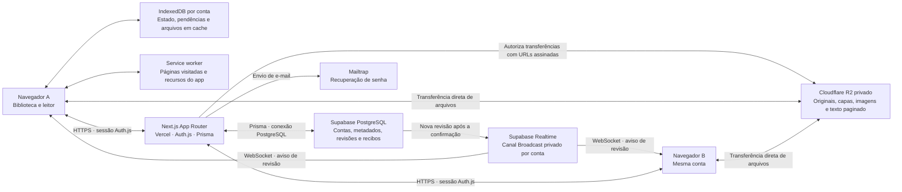
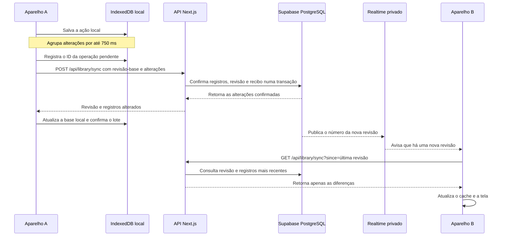

# Arquitetura do Le-Books

O Le-Books é uma biblioteca pessoal com leitor de PDF, EPUB, TXT e DOCX. O navegador mantém uma cópia local para acesso offline. O Supabase guarda o estado compartilhado entre aparelhos e o Cloudflare R2 guarda os arquivos. O Next.js autentica a conta e coordena o acesso aos dois serviços.

## Visão geral

| Camada | Responsabilidade |
| --- | --- |
| Interface | React e Mantine. Biblioteca, leitor, coleções, conhecimento, estatísticas e configurações compartilham o estado da conta em Zustand. |
| Navegador | IndexedDB mantém a biblioteca local, o último estado confirmado, o lote pendente e os arquivos já obtidos. Um registro temporário em localStorage protege edições pequenas até a gravação no IndexedDB. |
| Aplicação | As rotas Next.js validam a sessão, derivam o ID da conta no servidor, autorizam arquivos e processam mudanças. |
| Dados compartilhados | Prisma acessa o PostgreSQL. O schema `reader` armazena contas e registros da biblioteca. |
| Arquivos | `R2_BUCKET_NAME` seleciona o bucket privado. As chaves seguem `<conta>/originals/<id>` para originais e `<conta>/assets/<id>` para capas, imagens e texto convertido. |
| Notificações | O Realtime avisa que há uma revisão nova. Cada aparelho usa sua sessão para buscar as mudanças na API. |

## Importação, abertura e leitura offline

1. O navegador identifica o formato, extrai metadados e prepara os arquivos locais. O leitor usa PDF.js para PDF e epub.js para EPUB. O texto de TXT e DOCX é convertido em páginas no navegador. O app mantém o original e, quando disponível, a capa ou o texto paginado no IndexedDB.
2. A sincronização solicita URLs assinadas em `POST /api/library/files/:id`. O navegador envia os bytes diretamente ao R2. Uma capa, captura ou versão de leitura precisa estar no bucket antes de a API aceitar a referência que aponta para ela. O envio do original é independente do progresso de livros já sincronizados.
3. Ao abrir um livro, o leitor consulta primeiro o IndexedDB. Se precisar de um arquivo, chama `GET /api/library/files/:id`. A API confere a conta e redireciona para uma URL assinada do R2. O navegador guarda o arquivo baixado para a próxima leitura.
4. Em produção, o service worker guarda páginas já visitadas e recursos do app. Com a página e o arquivo em cache, o leitor pode reabrir e editar offline. A primeira sessão e o download de um arquivo ausente exigem rede.

## Sincronização entre aparelhos

- **Disparos.** O app envia ações locais como abrir um livro, virar página, anotar, criar uma coleção ou excluir um documento. A primeira carga busca os dados da conta. A abertura, o retorno à aba, a reconexão e a sincronização manual também verificam a revisão. Uma consulta com a revisão atual retorna uma lista vazia de mudanças. A biblioteca não faz consulta periódica em repouso.
- **Posição e tempo.** Página, percentual e localização formam uma posição. O relógio da posição resolve mudanças concorrentes, inclusive quando o usuário volta páginas. O tempo acumula localmente e segue com o próximo envio ou na tentativa de envio ao sair. A saída usa `keepalive` para lotes pequenos.
- **Recuperação.** O navegador conserva o lote e o ID até receber confirmação. Se perder a resposta, pode enviar o mesmo lote outra vez. O recibo impede contar duas vezes o tempo já confirmado. Se perder um aviso do Realtime, a próxima consulta por revisão recupera as mudanças. Edições incompatíveis podem ser resolvidas em Configurações com a opção de exportar um backup.

## Modelo de dados e acesso

| Registro | O que representa |
| --- | --- |
| `LibraryEntity` | Registros de documentos, posições, coleções, anotações, marcadores, preferências e tempo acumulado. O tipo e o ID identificam cada registro na conta. Exclusões têm registros próprios para que um aparelho atrasado as receba. |
| `LibraryRevision` | Revisão atual da conta. A API usa esse número para buscar apenas os registros que mudaram, e o banco o publica pelo Realtime. |
| `SyncOperation` | Recibo por conta e ID de operação. Permite repetir um envio cuja resposta se perdeu. |
| `StorageDeletion` | Fila de arquivos removidos ou substituídos. A coleta espera sete dias e confere se o objeto ainda tem referências antes de removê-lo. |
| `User`, `Installation`, `LoginAttempt`, `PasswordReset`, `RegistrationInvite` | Conta, identidade da instalação, tentativas de login, recuperação de senha e convites. |

O login usa Auth.js e sessões em cookie HTTP-only. Cada requisição de sincronização e arquivos deriva a conta dessa sessão. Para o Realtime, a rota `POST /api/library/realtime` emite um JWT de curta duração assinado pelo servidor. Uma política em `realtime.messages` permite que a conta receba eventos apenas do seu canal `library:<id da conta>`. O esquema `reader` fica fora da Data API. Os arquivos binários permanecem no bucket privado e no cache do aparelho.

## Onde está cada parte no código

| Local | Responsabilidade |
| --- | --- |
| [`src/components/layout/library-identity.tsx`](../src/components/layout/library-identity.tsx) | Carregamento inicial da conta e disparos de sincronização. |
| [`src/modules/library/`](../src/modules/library/) | Estado local, sincronização por revisão, conciliação, integração com Realtime e referências de arquivos. |
| [`src/modules/reader/`](../src/modules/reader/) e [`src/modules/documents/`](../src/modules/documents/) | Renderização, posição de leitura, anotações, exportação e importação. |
| [`src/app/api/`](../src/app/api/) | Rotas de login, biblioteca, arquivos, Realtime e convites. |
| [`prisma/schema.prisma`](../prisma/schema.prisma) e [`prisma/migrations/`](../prisma/migrations/) | Modelo do banco, política de acesso e gatilho de revisão. |
| [`src/infrastructure/`](../src/infrastructure/) e [`public/sw.js`](../public/sw.js) | Integrações com Prisma, R2, IndexedDB e Mailtrap, além do cache offline de páginas e recursos. |

As variáveis de ambiente, a migração e a configuração dos serviços estão no [README](../README.md).
