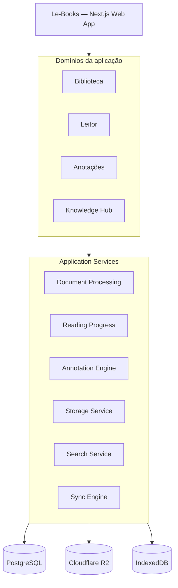
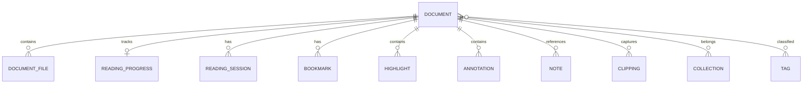
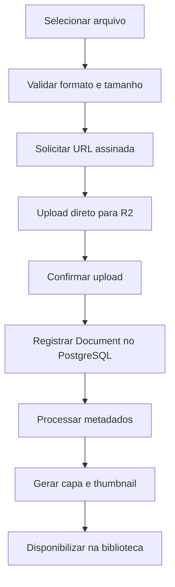

# Le-Books --- Especificação Técnica

https://www.apple.com/br/apple-books/

**Nome provisório:** Le-Books\
**Tipo:** Aplicação web pessoal\
**Proposta:** biblioteca digital para leitura, estudo, anotações e
organização de conhecimento, com experiência visual inspirada no Apple
Books.

------------------------------------------------------------------------

## 1. Visão do produto

O Le-Books reúne livros e documentos em uma biblioteca pessoal. O
usuário pode ler, marcar páginas, destacar trechos, escrever anotações,
desenhar sobre PDFs, capturar partes importantes e consultar todo esse
conhecimento em uma central unificada.

### Definições do produto

  -----------------------------------------------------------------------
  Decisão                             Definição
  ----------------------------------- -----------------------------------
  Plataforma                          Web responsivo

  Experiência principal               Desktop

  Dispositivos complementares         Tablet e smartphone

  Formatos                            PDF, EPUB, DOCX e TXT

  Edição de PDF                       Completa: caneta, marcações,
                                      comentários, formas e desenhos

  Direção visual                      Apple Books: minimalista, elegante
                                      e editorial

  Persistência                        PostgreSQL + Cloudflare R2

  Offline                             Cache local e sincronização
                                      posterior

  Usuários                            Um usuário inicialmente

  Evolução                            Arquitetura preparada para possível
                                      SaaS
  -----------------------------------------------------------------------

### Princípios

1.  A leitura é a experiência central, não a administração de arquivos.
2.  Anotações permanecem vinculadas ao documento original.
3.  O usuário consegue retomar exatamente de onde parou.
4.  Destaques e notas ficam disponíveis em uma central de conhecimento.
5.  O produto funciona sem depender de recursos de IA.
6.  A interface é discreta, sofisticada e sem excesso de elementos.

------------------------------------------------------------------------

## 2. Arquitetura técnica

### Estratégia arquitetural

Adotar um **monólito modular em Next.js**, sem microserviços
inicialmente.

A complexidade principal está no processamento de documentos, editor
PDF, sincronização e persistência de anotações. Microserviços
adicionariam custo operacional sem benefício proporcional nesta fase.

### Visão de alto nível



### Stack recomendada

  Camada         Tecnologia                 Responsabilidade
  -------------- -------------------------- -------------------------------
  Framework      Next.js 15+ / App Router   Aplicação web
  Linguagem      TypeScript                 Tipagem
  UI             Tailwind CSS               Componentes e estilos
  Ícones         Lucide                     Iconografia
  Estado local   Zustand                    Estado do leitor e editor
  Server state   TanStack Query             Cache e requisições
  Banco          Supabase (PostgreSQL)      Dados estruturados
  ORM            Prisma                     Persistência
  Storage        Cloudflare R2              Arquivos e imagens
  Cache local    IndexedDB                  Offline e autosave
  PDF            PDF.js                     Renderização
  EPUB           EPUB.js                    Renderização
  DOCX           Mammoth.js                 Conversão para HTML semântico
  TXT            Parser próprio             Leitura de texto puro
  Validação      Zod                        Schemas
  Deploy         Vercel                     Hosting

**NextAuth** para autenticação por e-mail e senha, com Prisma sobre o PostgreSQL do Supabase. Senhas com hash e rotas privadas protegidas. No início, uma conta pessoal; cadastro inicial fechado após criar o proprietário.

**Direção visual confirmada em 15/11/2026:** priorizar a fidelidade às imagens de `docs/design/images-reference/`: branco amplo, títulos serifados fortes, estantes abertas e navegação flutuante superior. Essa orientação substitui a sidebar dominante da primeira implementação visual.

**DOCX:** no MVP, oferecer leitura, navegação, busca e anotações, sem
edição do conteúdo original. Mammoth.js converte DOCX para HTML
semântico, mas não garante fidelidade de layouts complexos, tabelas
avançadas e elementos gráficos.

**PDF:** PDF.js será responsável pela renderização. A camada de anotação
será própria e independente do mecanismo de visualização.

------------------------------------------------------------------------

## 3. Estrutura de módulos

Organizar o código por domínio de negócio, não apenas por tipo de
componente.

``` text
src/
├── app/
│   ├── (app)/
│   │   ├── library/
│   │   ├── collections/
│   │   ├── reading/
│   │   ├── highlights/
│   │   ├── notes/
│   │   ├── history/
│   │   └── settings/
│   ├── reader/
│   │   └── [documentId]/
│   └── api/
│
├── modules/
│   ├── library/
│   ├── documents/
│   ├── reader/
│   ├── pdf-editor/
│   ├── annotations/
│   ├── bookmarks/
│   ├── collections/
│   ├── knowledge/
│   ├── reading-progress/
│   ├── search/
│   ├── storage/
│   └── synchronization/
│
├── components/
│   ├── layout/
│   ├── navigation/
│   ├── book-card/
│   ├── document-card/
│   ├── dialogs/
│   └── ui/
│
├── infrastructure/
│   ├── database/
│   ├── r2/
│   ├── pdf/
│   ├── epub/
│   └── docx/
│
├── shared/
│   ├── types/
│   ├── schemas/
│   ├── constants/
│   └── utils/
│
└── styles/
    └── tokens.css
```

### Responsabilidade de cada módulo

  Módulo             Responsabilidade
  ------------------ ------------------------------------
  Library            Listagem, organização e descoberta
  Documents          Upload, metadados e processamento
  Reader             Visualização dos formatos
  PDF Editor         Ferramentas de edição e desenho
  Annotations        Highlights, comentários e traços
  Bookmarks          Marcadores de páginas
  Collections        Agrupamento de documentos
  Knowledge          Central de notas e trechos
  Reading Progress   Posição e histórico
  Search             Pesquisa em documentos e notas
  Storage            Integração com R2
  Synchronization    Autosave e sincronização offline

Cada módulo deve conter seus próprios `components`, `hooks`, `services`,
`schemas` e `types` quando necessário. Evitar abstrações genéricas antes
de existir uma necessidade real de compartilhamento.

------------------------------------------------------------------------

## 4. Modelagem de dados

O modelo deve ser agnóstico ao formato do documento. PDF, EPUB, DOCX e
TXT compartilham as entidades de domínio, mas possuem estratégias
diferentes para representar localização e progresso.

### Entidades principais

  Entidade             Finalidade
  -------------------- ----------------------------------------------
  `Document`           Título, autor, tipo, descrição e status
  `DocumentFile`       Arquivo original, versão, tamanho e chave R2
  `DocumentMetadata`   ISBN, editora, idioma e capa
  `ReadingProgress`    Localização, percentual e última leitura
  `ReadingSession`     Início, fim e duração
  `Bookmark`           Localização e descrição
  `Highlight`          Texto, cor e localização
  `Annotation`         Tipo, geometria e dados da anotação
  `Note`               Conteúdo textual e relacionamentos
  `Clipping`           Imagem capturada de um trecho
  `Collection`         Agrupamento de documentos
  `Tag`                Organização transversal
  `DocumentTag`        Associação entre documento e tag

### Relações



### Contrato de localização

Não utilizar apenas `pageNumber` como referência. Cada formato possui
uma forma diferente de representar a posição.

``` ts
type DocumentLocation =
  | {
      type: "PDF";
      pageIndex: number;
      x?: number;
      y?: number;
      width?: number;
      height?: number;
    }
  | {
      type: "EPUB";
      cfi: string;
      href: string;
      progression?: number;
    }
  | {
      type: "DOCX" | "TXT";
      blockIndex: number;
      offset: number;
    };
```

Todas as anotações, marcadores e dados de progresso devem utilizar esse
contrato.

No PostgreSQL, a localização pode ser armazenada em JSONB, com índices
específicos para os campos mais consultados.

### Modelo de anotação

É importante diferenciar uma anotação textual de uma anotação visual.

``` ts
type AnnotationType =
  | "HIGHLIGHT"
  | "UNDERLINE"
  | "STRIKETHROUGH"
  | "FREEHAND"
  | "TEXT"
  | "ARROW"
  | "RECTANGLE"
  | "CIRCLE"
  | "IMAGE";

interface Annotation {
  id: string;
  documentId: string;
  type: AnnotationType;
  location: DocumentLocation;
  color?: string;
  content?: string;
  geometry?: {
    points?: Array<{ x: number; y: number }>;
    width?: number;
    height?: number;
  };
  createdAt: Date;
  updatedAt: Date;
}
```

Para desenhos, `points` representa os traços da caneta. A geometria deve
ser normalizada em relação à página, não em pixels da tela. Assim, o
desenho permanece alinhado quando zoom ou resolução mudam.

------------------------------------------------------------------------

## 5. Editor PDF

O editor deve ser um subsistema independente dentro do módulo Reader.

### Camadas de renderização

Cada página PDF será composta por quatro camadas:

``` text
┌─────────────────────────────────┐
│ Interaction Layer               │
│ Seleção, mouse, touch e caneta   │
├─────────────────────────────────┤
│ Annotation Layer                │
│ SVG / Canvas — desenhos         │
├─────────────────────────────────┤
│ Text Layer                      │
│ Seleção de texto e pesquisa     │
├─────────────────────────────────┤
│ PDF Canvas                      │
│ PDF.js — renderização original  │
└─────────────────────────────────┘
```

### Ferramentas da toolbar

  Ferramenta   Comportamento
  ------------ -------------------------------
  Select       Selecionar texto e objetos
  Hand         Mover a página
  Highlight    Marca-texto
  Underline    Sublinhado
  Pen          Escrita livre
  Pencil       Desenho livre
  Eraser       Apagar traços
  Text         Inserir caixas de texto
  Rectangle    Desenhar retângulos
  Circle       Desenhar círculos
  Arrow        Setas e indicadores
  Image        Inserir imagens
  Comment      Comentário associado a trecho

Recursos complementares:

-   Undo / Redo.
-   Cores personalizáveis.
-   Espessura do traço.
-   Opacidade.
-   Zoom.
-   Navegação entre páginas.
-   Exportação de PDF anotado.

### Persistência das anotações

Não salvar o PDF inteiro a cada alteração.

Fluxo recomendado:

1.  Usuário realiza uma marcação.
2.  O editor gera um objeto de anotação.
3.  A anotação é atualizada imediatamente no estado local.
4.  O IndexedDB recebe uma cópia persistente.
5.  Uma fila envia a alteração para a API.
6.  PostgreSQL persiste o objeto.
7.  Quando necessário, o sistema gera uma versão exportada do PDF com as
    anotações incorporadas.

Isso reduz tráfego, evita reprocessar arquivos grandes e permite
recuperação após falhas.

### Coordenadas e interação

O editor deve:

-   Tratar cada página como um sistema de coordenadas próprio.
-   Converter coordenadas entre PDF, viewport e coordenadas
    normalizadas.
-   Suportar Pointer Events.
-   Capturar pressão da caneta quando disponível.
-   Manter o alinhamento das marcações em diferentes níveis de zoom e
    resoluções.

### Exportação

Diferenciar dois conceitos:

-   **Original:** arquivo importado, imutável.
-   **Annotated Export:** nova versão do PDF contendo as marcações
    incorporadas.

A exportação nunca deve destruir ou alterar o original.

------------------------------------------------------------------------

## 6. Cloudflare R2 e sincronização

### Estrutura de armazenamento

``` text
personal-reader/
├── documents/
│   └── {documentId}/
│       ├── original.pdf
│       └── original.epub
├── covers/
│   └── {documentId}.webp
├── clippings/
│   └── {documentId}/
│       └── {clippingId}.webp
├── exports/
│   └── {documentId}/
│       └── {versionId}.pdf
└── thumbnails/
    └── {documentId}/
```

### Fluxo de upload



### Estratégia de armazenamento

  Conteúdo                  Armazenamento
  ------------------------- ---------------
  PDF original              R2
  EPUB original             R2
  Screenshots de trechos    R2
  Capas e thumbnails        R2
  Traços da caneta          PostgreSQL
  Highlights                PostgreSQL
  Comentários               PostgreSQL
  Progresso de leitura      PostgreSQL
  Configurações do leitor   PostgreSQL
  Alterações pendentes      IndexedDB

### Upload

O upload deve ser feito diretamente do navegador para o R2 por meio de
URLs pré-assinadas, evitando trafegar arquivos grandes pela API da
aplicação.

### Offline e sincronização

Implementar:

-   IndexedDB para progresso e anotações pendentes.
-   Cache de documentos recentemente abertos.
-   Cache de capas e thumbnails.
-   Fila de sincronização.
-   Identificadores UUID para operações.
-   Versionamento de atualização por entidade.
-   Idempotência nas operações de sincronização.

Não sincronizar PDFs completos automaticamente para todos os
dispositivos. O usuário poderá definir quais documentos deseja manter
disponíveis offline.

------------------------------------------------------------------------

## 7. Design System --- Apple Books

### Direção visual

A interface deve parecer um produto editorial, não um dashboard
administrativo.

**Light mode:** branco, superfícies suaves e contraste editorial.\
**Dark mode:** grafite, superfícies profundas e capas em destaque.

### Tokens iniciais

  Token               Light       Dark
  ------------------- ----------- -----------
  Background          `#F7F7F5`   `#171717`
  Surface             `#FFFFFF`   `#222222`
  Surface Secondary   `#F0F0EE`   `#2B2B2B`
  Text Primary        `#1C1C1E`   `#F5F5F5`
  Text Secondary      `#777777`   `#A1A1A1`
  Border              `#E5E5E3`   `#383838`
  Accent              `#B58B61`   `#D0A678`
  Selection           `#F7E7A5`   `#66552A`

### Tipografia

-   Interface: SF Pro Display, com Inter como fallback.
-   Leitura: Georgia ou outra fonte serifada editorial.
-   Código e metadados técnicos: SF Mono ou monospace.

### Dimensões iniciais

  Elemento                             Dimensão
  -------------------- ------------------------
  Sidebar                                250 px
  Toolbar superior                        58 px
  Espaçamento padrão                       8 px
  Card de livro          140--180 px de largura
  Border radius                       10--14 px
  Modal                             480--640 px

### Princípios de interface

-   Evitar cards excessivos.
-   A biblioteca deve ter aparência de estante, não de painel de
    métricas.
-   Capas devem receber destaque visual.
-   A tela de leitura deve reduzir distrações.
-   Controles do leitor devem aparecer quando necessários.
-   Oferecer light e dark mode.
-   Manter consistência entre desktop, tablet e smartphone.

------------------------------------------------------------------------

## 8. Telas e experiência do usuário

### 8.1 Biblioteca

Funcionalidades:

-   Busca global.
-   Seção "Continuar lendo".
-   Grid de livros e documentos.
-   Coleções e filtros.
-   Ordenação por recentes, título, autor e progresso.
-   Importação de arquivos.
-   Alternância entre visualização em grid e lista.

### 8.2 Reader

Funcionalidades:

-   Leitura imersiva.
-   Toolbar de edição.
-   Navegação por páginas e sumário.
-   Anotações laterais.
-   Progresso automático.
-   Zoom e modo foco.
-   Atalhos de teclado.
-   Painel de miniaturas.

### 8.3 Knowledge Hub

Funcionalidades:

-   Todos os destaques.
-   Notas pessoais.
-   Capturas de trechos.
-   Filtros por livro, tipo, cor e data.
-   Pesquisa.
-   Navegação do trecho salvo para sua posição original no documento.

### 8.4 Navegação principal

-   Biblioteca.
-   Lendo agora.
-   Quero ler.
-   Coleções.
-   Destaques.
-   Anotações.
-   Conhecimento.
-   Clippings.
-   Estatísticas.
-   Configurações.

------------------------------------------------------------------------

## 9. Rotas e API

### Rotas da aplicação

  Rota                     Tela
  ------------------------ -------------------------
  `/library`               Biblioteca
  `/library/recent`        Recentes
  `/library/reading`       Lendo agora
  `/collections`           Coleções
  `/collections/[id]`      Detalhes da coleção
  `/reader/[documentId]`   Leitor
  `/highlights`            Destaques
  `/notes`                 Anotações
  `/clippings`             Capturas
  `/knowledge`             Central de conhecimento
  `/history`               Histórico
  `/statistics`            Estatísticas
  `/settings`              Configurações

### Endpoints principais

``` text
/api/documents
/api/documents/[id]
/api/documents/upload-url
/api/documents/[id]/progress

/api/annotations
/api/annotations/[id]

/api/bookmarks
/api/collections
/api/notes
/api/highlights
/api/clippings

/api/storage/presigned-url
/api/sync
/api/search
```

REST é suficiente inicialmente. Não há necessidade de GraphQL.

------------------------------------------------------------------------

## 10. Requisitos não funcionais

  Requisito        Critério
  ---------------- ----------------------------------------------------
  Performance      Biblioteca sem carregamento de todos os documentos
  Leitor           Renderização progressiva de páginas
  Autosave         Persistência local imediata
  Sincronização    Reenvio automático de alterações pendentes
  Segurança        URLs assinadas e acesso privado ao R2
  Integridade      Original nunca sobrescrito
  Responsividade   Desktop, tablet e smartphone
  Recuperação      Restaurar anotações após recarregamento
  Acessibilidade   Teclado, contraste e navegação acessível

### Cuidados técnicos

-   PDFs grandes devem ser carregados sob demanda, com suporte a HTTP
    Range quando disponível.
-   Anotações devem possuir identificadores estáveis e versionamento.
-   A fila offline precisa ser idempotente.
-   A exclusão de documentos deve considerar notas e anotações
    relacionadas.
-   O R2 deve permanecer privado, sem exposição pública dos documentos
    pessoais.
-   DOCX deve ser tratado como documento convertido para leitura, não
    como editor Word.
-   Para EPUB, preservar CFI e identificador do capítulo para recuperar
    a posição.

------------------------------------------------------------------------

## 11. Plano de implementação

  Entrega   Escopo                     Resultado
  --------- -------------------------- ----------------------------------
  E1        Fundação + Design System   Estrutura e interface
  E2        Biblioteca + Storage       Importação e organização
  E3        Reader PDF + EPUB          Leitura funcional
  E4        PDF Editor                 Caneta, highlights e comentários
  E5        Knowledge Hub              Notas, destaques e clippings
  E6        Offline + otimizações      Sincronização e estabilidade

### Critérios de conclusão do MVP

-   [ ] Importar PDF, EPUB, DOCX e TXT.
-   [ ] Visualizar todos os formatos.
-   [ ] Retomar leitura na posição exata.
-   [ ] Criar e excluir marcadores.
-   [ ] Grifar trechos.
-   [ ] Escrever e desenhar em PDFs.
-   [ ] Inserir comentários.
-   [ ] Apagar e desfazer marcações.
-   [ ] Criar screenshots de trechos.
-   [ ] Persistir arquivos no R2.
-   [ ] Consultar todas as anotações em um único lugar.
-   [ ] Exportar PDF com anotações incorporadas.
-   [ ] Recuperar alterações após recarregar a aplicação.

------------------------------------------------------------------------

## 12. Decisões técnicas consolidadas

1.  **Next.js + TypeScript + Tailwind:** base customizável e
    leve.
2.  **PDF.js + camada própria de anotações:** controle sobre a
    experiência do editor.
3.  **IndexedDB + Supabase (PostgreSQL), com Prisma como ORM:** experiência local rápida com
    persistência remota.
4.  **R2 privado:** armazenamento de arquivos separado da aplicação.
5.  **Monólito modular:** simplicidade operacional.
6.  **Design responsivo desde o início:** experiência adaptada a
    desktop, tablet e smartphone.

### Fora do escopo inicial

Não implementar agora:

-   IA e chat com documentos.
-   OCR avançado.
-   Sincronização em tempo real entre múltiplos dispositivos.
-   Edição do conteúdo interno de DOCX.
-   Edição estrutural do conteúdo original de PDFs.

Essas funcionalidades aumentariam o escopo sem serem necessárias para
validar o produto.

------------------------------------------------------------------------

## 13. Protótipo visual e direção de design

O protótipo deve contemplar três telas principais:

### Tela 01 --- Biblioteca

-   Sidebar de navegação.
-   Busca global.
-   Seção "Continuar lendo".
-   Grid de capas.
-   Coleções e filtros.
-   Botão de importação.

### Tela 02 --- Reader

-   Documento centralizado.
-   Miniaturas de páginas na lateral.
-   Toolbar flutuante de edição.
-   Painel de anotações e destaques.
-   Progresso e navegação.

### Tela 03 --- Knowledge Hub

-   Lista unificada de destaques, notas e clippings.
-   Filtros por tipo e documento.
-   Busca.
-   Acesso à localização original do trecho.

A identidade visual deve seguir a linguagem editorial do Apple Books:
superfícies limpas, tipografia refinada, capas em destaque, espaçamento
generoso e controles discretos.

------------------------------------------------------------------------

## 14. Recomendação de execução

Começar pela biblioteca e pelo leitor PDF, mas projetar desde o início o
modelo de localização e anotações que atenderá aos quatro formatos.

A prioridade técnica é construir um editor PDF confiável, com
persistência independente do arquivo original. A prioridade de produto é
entregar uma experiência de leitura que seja agradável o suficiente para
uso diário.

**Resultado esperado:** um aplicativo pessoal para ler, estudar,
destacar, anotar, capturar e recuperar conhecimento de livros e
documentos em uma única biblioteca digital.
